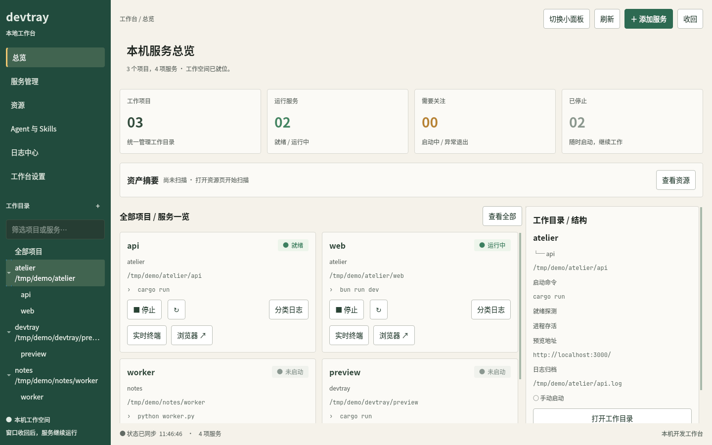
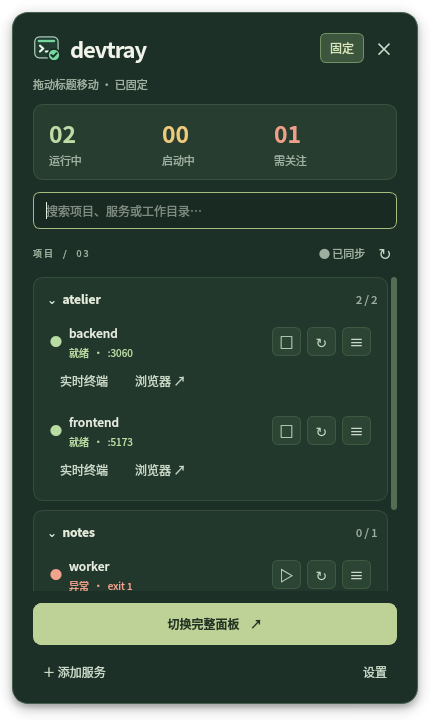
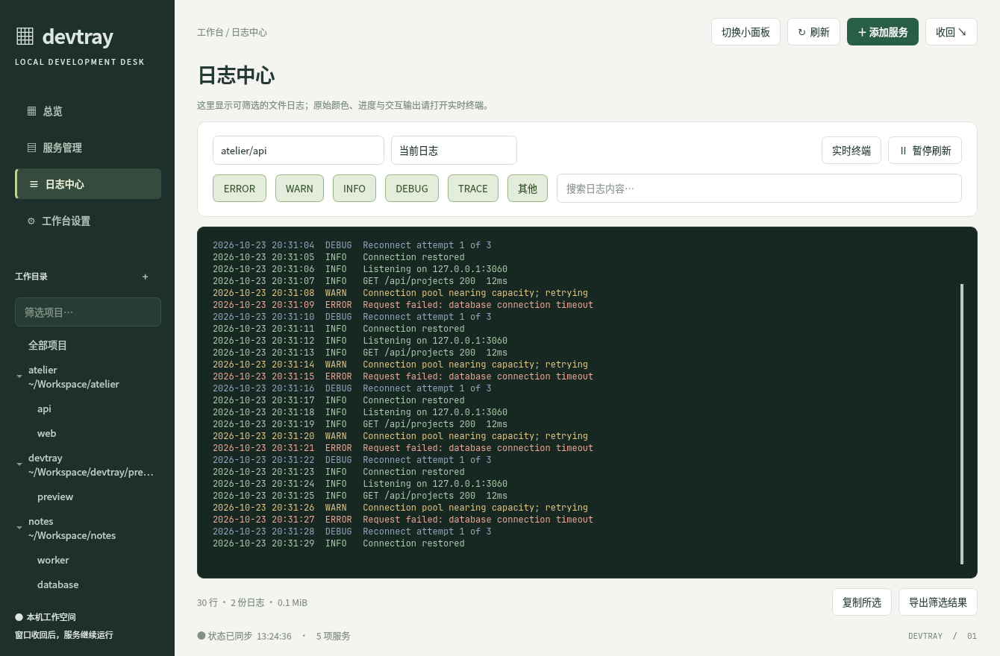

# devtray

**Start development projects quickly. Let your agent run them. Keep the logs in your hands.**

[简体中文](README.zh-CN.md) · [Configuration example](examples/config.toml) · [Changelog](CHANGELOG.md)

[Development status (Chinese)](docs/development-status.md) · The latest workspace, resource, skill, and alert changes are documented under Unreleased.

A Linux tray app for managing development services such as `cargo run`, `bun run dev`, and `npm run dev`. Group services by project, start them from a desktop panel or an AI agent, and inspect the same processes and logs from either side.

Agents often leave development servers in background shells that are awkward to find or inspect. devtray puts those services in named tmux sessions and gives developers a visible place to check status, read errors, copy logs, and restart a service themselves. AI-assisted debugging and hands-on debugging can use the same workspace.



## What you get

- Pine-green full workspace, compact panel, and native tray menu, with a persistent project/service tree, search, and collapse state.
- Projects containing multiple services, with individual and project-wide start/stop/restart controls.
- Readiness checks using log patterns or a TCP port; failure indicators and optional desktop notifications.
- Searchable, filterable logs with restart history, rotation, selection/copy, and export.
- One-click access to the original tmux terminal, project directory, and browser preview.
- A CLI and built-in stdio MCP server for agents, sharing the same service management code as the desktop UI.
- Three-column project resource management with cross-project selection, combined preflight, sequential cleanup, and audit records.
- Agent/Skills inventory, source and version detection, GitHub skill update checks, and skill installation/upgrade/removal with snapshots and drift protection.
- Persistent service/project alert acknowledgement and a Log Center exception list; new failed runs alert again.

Services and log collectors live in tmux. Hiding the panel, quitting the tray, or restarting devtray does not stop them. A reboot or logout that terminates the user's processes still can.

**v0.1.1 targets Linux.** The interface and CLI messages are currently primarily Chinese; these instructions are available in English and Chinese. There is no native macOS or Windows app in this release.

## Dependencies

| Component | Required for |
| --- | --- |
| `tmux` and a POSIX shell (`sh`) | Starting and managing services, including through CLI/MCP |
| D-Bus session and a StatusNotifierItem/AppIndicator-compatible tray host | The tray; use a desktop/panel with SNI support |
| Python 3 + `PySide6` (`QtWidgets`, `QtNetwork`) | Compact and full desktop panels; Python 3.10+ is recommended |
| A terminal emulator | Opening an interactive tmux terminal |
| `xdg-open` (`xdg-utils`) | Opening preview URLs and project directories |
| `notify-send` | Optional failure notifications |
| `yad` | Optional tray/CLI service-editing forms; the Qt panel has its own forms |
| Rust stable + Cargo + a C linker | Building from source; v0.1.1 was tested with Rust 1.97.1 |
| Your project's runtimes and dependencies | Whatever the configured command needs: Rust, Node.js, Bun, Python, etc. |

CLI and MCP service management do not require the tray, Python, or Qt. devtray does not install dependencies for your projects. Rust dependencies are pinned in [Cargo.lock](Cargo.lock); no Node.js frontend or frontend build server is needed. Python UI source and generated tray icons are embedded in the Rust binary.

Example system dependencies:

```bash
# Debian / Ubuntu (install Rust separately using rustup)
sudo apt update
sudo apt install build-essential tmux dbus xdg-utils libnotify-bin python3 python3-venv

# Arch Linux
sudo pacman -S --needed base-devel rust tmux dbus xdg-utils libnotify python pyside6
```

If your distribution does not provide PySide6, use a virtual environment:

```bash
python3 -m venv "$HOME/.local/share/devtray/venv"
"$HOME/.local/share/devtray/venv/bin/pip" install PySide6
export DEVTRAY_PYTHON="$HOME/.local/share/devtray/venv/bin/python"
```

Persist `DEVTRAY_PYTHON` in your shell configuration for CLI launches, and in the systemd override below for the tray service. Qt also needs a working Wayland or X11 environment and the matching system libraries; virtualenvs do not replace those desktop dependencies.

## Install and start

### From source

```bash
git clone https://github.com/luisifa/devtray.git
cd devtray
./scripts/install-local.sh
export PATH="$HOME/.cargo/bin:$PATH"

# Start the tray now and on future logins
systemctl --user enable --now devtray.service

devtray panel --mode full
devtray check
```

The installer builds with `Cargo.lock` and installs the executable, icons, desktop launcher, and a user systemd unit. It expects Cargo's default installation location, `~/.cargo/bin`. First launching the tray or panel creates `~/.config/devtray/config.toml` with commented examples. An empty project list is expected until you add your services.

Without systemd, run `devtray` from a graphical session and add it to your desktop's startup applications. For **CLI/MCP only**, use `cargo install --locked --path .`; this installs just the executable, without the desktop launcher or systemd unit. Create an empty configuration before first use:

```bash
mkdir -p "${XDG_CONFIG_HOME:-$HOME/.config}/devtray"
# Create only if absent; preserve existing configuration.
touch "${XDG_CONFIG_HOME:-$HOME/.config}/devtray/config.toml"
devtray status --json
```

### From release packages

Download a matching artifact from [GitHub Releases](https://github.com/luisifa/devtray/releases). Verify it against `SHA256SUMS` from the same release.

```bash
# Debian / Ubuntu: apt also resolves package dependencies
sudo apt install ./devtray_0.1.1-1_amd64.deb

# Fedora / RPM-based systems
sudo dnf install ./devtray-0.1.1-1.x86_64.rpm

# After installing either package
mkdir -p "$HOME/.local/state/devtray"
systemctl --user daemon-reload
systemctl --user enable --now devtray.service
```

Alternatively, unpack the Linux tarball and install its `devtray` executable into a directory on `PATH`. Tarballs include documentation and desktop assets but do not install them automatically. PySide6 is optional and must be installed separately for all formats. If you previously installed from source, its user unit takes precedence over the packaged unit; use `systemctl --user cat devtray` to check which executable it starts.

## Add a project

**In the full panel:** open service management and choose “添加服务” (Add service). Enter a project name, service name, working directory, and command. A new project name creates a project; the same name adds another service to it. The form validates the configuration before saving and preserves TOML comments.

**In TOML:** edit `~/.config/devtray/config.toml`. Use [examples/config.toml](examples/config.toml) as a starting point, replacing the paths with existing directories on your machine:

```toml
[settings]
poll_ms = 2000
notify = true
notify_debounce_s = 60
disk_cache_ttl_s = 600
skill_check_ttl_s = 21600   # skills upstream check cache (6h)
mcp_writes = "ask"   # ask (desktop yad approval) / deny / allow
# clean_extra_dirs = ["dist"]   # dist/build/vendor stay excluded by default
# terminal = "kitty"

[[project]]
name = "my-app"
root = "~/Workspace/my-app"   # optional; inferred from service.cwd when omitted

[[project.service]]
name = "backend"
cwd = "~/Workspace/my-app/backend"
cmd = "cargo run"
autostart = false
ready = "Listening on"
port = 3000
url = "http://localhost:3000/"
[project.service.env]
RUST_LOG = "debug"

[[project.service]]
name = "frontend"
cwd = "~/Workspace/my-app/frontend"
cmd = "bun run dev"
ready = "ready in"
url = "http://localhost:5173/"
```

Add another `[[project]]` block for another project, or more `[[project.service]]` blocks beneath the current project. Use ASCII project/service identifiers to avoid collisions in sanitized tmux session names.

| Field | Meaning |
| --- | --- |
| `name` | Required project/service identifier; targets use `project/service` |
| `root` | Optional project root used by disk scanning and "open directory". Inferred from the common ancestor of `service.cwd` when omitted; single-cwd projects pointing at a subdirectory should set it explicitly. |
| `cwd` | Required existing working directory; absolute paths and `~/...` are recommended |
| `cmd` | Required command, executed using `sh -lc` inside tmux |
| `autostart` | Default `false`; start when the tray starts if the service is not already running |
| `ready` | Optional regular expression matched against that service's tmux output |
| `port` | Optional local TCP readiness check; either `ready` **or** `port` passing means ready |
| `url` | Optional preview URL; otherwise inferred from logs, then from `port` |
| `env` | Optional environment variable table for this service |
| `log_file` | Optional separate log file; relative paths resolve against `cwd`; cannot be shared between services |

The tray reloads configuration automatically and retains the last valid configuration if a new edit is invalid. CLI/MCP calls read the file each time and report invalid configuration. Changing a running service's command/environment requires restarting that service; editing the file does not restart it automatically. `ready` is often more precise than `port`, because an unrelated process may already own that port.

## Everyday use

After a service exits with an error, use **Mark as read** on its service card, compact-panel row, or tray service menu. The acknowledgement is persisted for that failed process: its exit code, terminal, and logs remain available, while the tray stops highlighting that acknowledged failure. A new failed run alerts again. The footer also offers **Mark all failures as read** without requiring an error banner. CLI: `devtray ack project/service`. Restart the tray and panel after installing an updated binary; compiling alone does not replace running processes.


In the full panel, **Mark as read** sits beside the failed service status. Project headings in Overview and Service Management provide an acknowledgement scoped to that project. The Log Center includes an exception list with project and read-state filters, plus per-row log navigation and acknowledgement. It lists currently retained failed exits, rather than historical incidents. Acknowledging preserves log filters, pause state, and selected text.

Left-click the tray icon to show/hide the last-used panel; the first launch uses the compact panel. Right-click for the native menu. Switch between compact/full modes inside the panels. Closing a panel or pressing Esc hides it; services keep running.



```bash
devtray                          # Run the tray
devtray panel --mode full         # Open and remember full mode
devtray panel --mode small        # Open and remember compact mode
devtray panel --toggle            # Show/hide
devtray panel --target my-app/backend  # Jump to service logs
devtray panel --quit              # Exit the UI process; keep services running

devtray status
devtray status --json
devtray start my-app/backend
devtray restart my-app/frontend
devtray stop my-app/backend
devtray terminal my-app/frontend  # Attach in your terminal emulator
devtray open my-app/frontend      # Open browser preview
devtray edit my-app/backend       # yad form, or editor fallback
devtray help
```

Targets accept `project/service`, a unique service name, or the tmux session name (`devtray-my-app-backend`). **`start` recreates an existing session, including a running service.** Check status before calling it; use `restart` when you intend to restart. Stop sends Ctrl-C, waits up to three seconds, then removes the session. In an attached tmux terminal, `Ctrl-b`, then `d` detaches without stopping the service.

| Machine state | Meaning |
| --- | --- |
| `not_started` | No matching tmux session; also shown after stop removes the session |
| `running` | Process alive, no readiness check configured |
| `starting` | Process alive, waiting for a readiness check |
| `ready` | Readiness check passed |
| `exited_ok` | Process exited with code 0; pane retained |
| `exited_failed` | Process exited with a nonzero code; pane retained |
| `exited_signal` | Pane records a signal exit |

The tray shows green for running/ready, yellow for starting, red for failure/configuration errors, and gray when inactive. Readiness is latched for a pane's lifetime. There is no continuous health check or crash auto-restart in v0.1.1.

Use **Clear notice** in either panel or the tray menu to acknowledge current alerts and restore the tray badge. Service exit states and logs remain visible, and a new failure alerts again. Desktop notifications request an eight-second expiry.

Agent discovery supplements PATH with common user install directories, including `~/bin` and `~/.kimi-code/bin`, and now supports Kimi and Hermes. Both lists have context menus and an explicit action button. Copy details are secondary; write protection remains active. Agent re-detection reads local versions, while Skills update checking compares supported GitHub tree hashes.

## Disk usage and build caches

The pine-green workspace keeps the global project/service tree and search. Resources has three columns: projects, scanned directories, and a cleanup selection grouped by project. Choices survive project and page changes. All selected projects are checked before a combined confirmation; cleanup then runs sequentially. A failure stops subsequent projects and keeps unfinished choices. Remove a choice, clear the selection, or stop subsequent projects without deleting directories. Rescans invalidate choices when roots or cleanup evidence change.

The light prototype remains a design alternative; runtime theme switching is not included. See [panel implementation and Qt screenshots](docs/control-panel.md).


The full panel adds a **Resources** page: it lists rebuildable directories such as `target`, `node_modules`, `.venv`, and `__pycache__` per project, shows allocated and logical size, and offers "open directory" plus "clean selected". The overview only shows a one-line asset summary backed by the scan cache (10 minutes by default).

A directory is only deletable when the evidence matches: `target` needs `Cargo.toml` plus build traces, `node_modules` needs `package.json` and a lockfile, `.venv` needs `pyvenv.cfg` plus `uv.lock`/`requirements.txt`, tool caches must be non-empty. Anything tracked by git, containing a mount point, or under an overly broad root (`/`, home, `~/Workspace`, more than 50 children) is read-only. A candidate is not automatically safe to delete.

```bash
devtray disk                              # all projects
devtray disk my-app --json                # structured output
devtray disk --refresh                    # ignore the cache and rescan
devtray disk open my-app                  # open the project root
devtray disk open my-app/backend          # open a service working directory
devtray disk clean my-app --kind node_modules --dry-run
devtray disk clean my-app --kind node_modules --yes
devtray disk clean my-app --all --yes     # every eligible candidate in the project
```

Cleaning checks everything twice, once before confirmation and once after taking a cross-process lock. It refuses when a service is running, the candidate contains a mount point, files are tracked by git, the path escapes the project root, or a symlink is involved. Without `--kind`/`--path`/`--all` nothing is selected; `--dry-run` only prints the plan. Deletion is irreversible, and allocated bytes are not a promise of reclaimed space (hardlinks or an external store may still hold the data). Audit records go to `~/.local/state/devtray/audit.jsonl`; jobs live under `~/.local/state/devtray/jobs/`.

## Agents and skills

The full panel's **Agent & Skills** page detects installed agents and reconciles the skills inventory. Skill install, upgrade, delete, and snapshot restore all use the write gate.

Agent detection looks up `claude`, `codex`, `pi`, `dsh`, `gemini`, `opencode`, `qwen`, and `aider` on `PATH`, parses `--version`, determines provenance (pacman/dpkg package, npm global, native install), and prints the **suggested** upgrade command. Commands that need sudo are marked and never executed automatically. On this machine Claude Code is a native install (`claude update`), Codex is the CachyOS `openai-codex` package (`sudo pacman -S openai-codex`), Pi is a self-managed `~/.pi/agent` install (`pi update self`), and DSH is the npm global package `@deepseek-ai/dsh` (`npm i -g @deepseek-ai/dsh@latest`).

```bash
devtray agents
devtray agents --json
```

Skills use `~/.agents/.skill-lock.json` (v3) and `~/.agents/skills/` as the source of truth: lock entry plus directory means managed; directory without a lock entry means unknown source. The version shown is the short upstream tree hash, not semver, alongside the install time. `devtray skills check` compares the upstream GitHub tree sha: results are cached for six hours (`skill_check_ttl_s`), `--refresh` bypasses the cache, `gh api` is preferred, and anonymous `curl` is the fallback. Rate limits or network failures show "cannot check" rather than a false update. The panel's "check updates" button uses the same path. The page also inspects agent copies such as `~/.claude/skills` and `~/.codex/skills`: symlinks compare targets, copies are compared with `diff -rq`, and any difference is marked "copy drift". Status combines update state ("update available", "up to date", "cannot check") with copy drift. Project-level skills are out of scope for now.

Upgrade/remove pin `npx --yes skills@1.7.4`. Before writing, devtray enumerates the canonical store, every agent copy, and the lock, then snapshots them under `~/.local/state/devtray/skills-backup/<skill>/<timestamp>/` (three most recent kept). Any independent copy with different content refuses by default; `--allow-drift` is required. Verification is strict: upgrade keeps the canonical directory and lock entry, remove requires all directories, copies, and the lock entry to be gone. Jobs live under `state/jobs/` and deletions/updates are audited in `audit.jsonl`. Restore replaces the canonical directory and agent copies by default and **does not modify the lock**, so the skill will show as diverged; `--restore-lock` atomically writes back only that skill's entry (other entries stay byte-identical). Installation parses a GitHub URL, `owner/repo@skill`, or a bare name (skills.sh search, unique hit only), prechecks `SKILL.md` candidates through the GitHub tree, installs with explicit `-a` targets and the pinned CLI, then verifies the lock, canonical directory, and every agent copy. Existing skills are refused unless you upgrade them or pass `--allow-existing`.

```bash
devtray skills
devtray skills --json
devtray skills check            # compare upstream tree sha (6h cache)
devtray skills check --refresh  # bypass the cache
devtray skills open
devtray skills upgrade alpha --dry-run        # print affected paths only
devtray skills upgrade alpha --yes            # upgrade (snapshot first)
devtray skills remove alpha --yes             # remove (snapshot first)
devtray skills upgrade alpha --yes --allow-drift  # overwrite drifted copies explicitly
devtray skills restore alpha --dry-run            # list available snapshots
devtray skills restore alpha --snapshot <ID> --yes            # restore files and copies
devtray skills restore alpha --snapshot <ID> --restore-lock --yes  # also restore the lock entry
devtray skills install owner/repo --skill alpha --agent claude-code --dry-run
devtray skills install owner/repo --skill alpha --agent claude-code --yes
devtray skills install https://github.com/owner/repo/tree/main/skills/alpha --yes
devtray skills install huashu-design --yes      # bare name uses skills.sh search (unique hit only)
```

## Logs you can inspect yourself



```bash
devtray logs my-app/backend -n 200
devtray logs my-app/backend --level warn,error
devtray logs my-app/backend --level info --search request
devtray logs my-app/backend --history --level error
devtray logs my-app/backend --run 1 --json
```

Logs default to `${XDG_STATE_HOME:-~/.local/state}/devtray/logs/`. Each service keeps the current `.log` plus up to ten archives (`.log.1` is newest). Restart and approximately 10 MiB size rotation both create archives. Retention is about 110 MiB per service, with small write-block overshoot; pre-existing oversized files may exceed this. Archive numbers move as files rotate; they are not permanent run IDs.

Levels are `trace`, `debug`, `info`, `warn`, `error`, and `other`. Search is case-insensitive. Queries filter first and return the latest matching lines; they scan at most the last 2 MiB of each selected file. CLI results are capped at 10,000 lines, MCP at 5,000, and the panel at 2,000. Use the raw files for older content. JSON queries include truncation information.

In the panel, selecting text or scrolling up pauses refresh; resume explicitly when ready. Export saves the currently displayed filtered result. Logs remain readable after a service stops or crashes. The original tmux terminal stays available separately; devtray does not modify your global tmux keybindings.

## Connect an agent through MCP

The agent launches **`devtray mcp`** as a local stdio subprocess. No HTTP server, listening port, or separate daemon is needed. The tray does not have to be running. Use the same Unix user and configuration as the desktop app to see the same services. The agent needs access to tmux's local socket, project directories, and log files.

For Codex (syntax also available in `codex mcp add --help`):

```bash
codex mcp add devtray -- "$HOME/.cargo/bin/devtray" mcp
codex mcp list
```

For other stdio MCP clients, adapt this configuration to the client's settings format:

```json
{
  "mcpServers": {
    "devtray": {
      "command": "/home/YOUR_USER/.cargo/bin/devtray",
      "args": ["mcp"],
      "env": {
        "DEVTRAY_CONFIG": "/home/YOUR_USER/.config/devtray/config.toml"
      }
    }
  }
}
```

Use `/usr/bin/devtray` for a distribution package, or the actual absolute path reported by `command -v devtray`. Replace `YOUR_USER`; JSON values do not expand `~` or `$HOME`. Reload/reconnect your MCP client after registration. See the [official Codex MCP documentation](https://developers.openai.com/codex/mcp/) for client configuration.

| Tool | Arguments | Purpose |
| --- | --- | --- |
| `devtray_status` | None | List services, machine states, commands, logs, and preview URLs |
| `devtray_logs` | `target`; optional `lines`, `level`, `search`, `history` | Read current or archived logs; default 80 lines |
| `devtray_start` | `target` | Start/recreate a service, then return its new status |
| `devtray_stop` | `target` | Stop a service |
| `devtray_restart` | `target` | Stop then start a service |
| `devtray_open_preview` | `target` | Open the preview on the user's desktop |
| `devtray_disk` | optional `project` | Read cached build-directory usage (allocated/logical, deletable flags) |
| `devtray_job` | `job_id`; optional `cancel` | Query a background cleanup job's state, progress, and result |
| `devtray_clean` | `project`; one of `kinds` / `paths` / `all` | Create a cleanup job and return its `job_id` |

MCP writes follow `mcp_writes`: `ask` shows a desktop yad dialog (60 seconds without a response counts as denial), `deny` refuses immediately, and only `allow` skips the dialog. `devtray_clean` only creates a job and returns `job_id` without blocking the connection; poll `devtray_job` until `done` / `error` / `cancelled`. Execution still re-checks running services and mount points, so approval does not guarantee a successful deletion.

Suggested agent workflow: **status → start if needed → wait and recheck readiness → read logs on failure**. A successful start call means the process was launched, not that compilation or startup has finished. The MCP status response can include `advice` for starting/failed services. The CLI's JSON status response contains `services`; its human-readable output includes advice when needed.

Example request to your agent:

> Use devtray to start my-app's backend and frontend. Check their status first and leave already-running services alone. Wait for readiness, and inspect error logs if startup fails. I will review the same logs in the desktop panel.

For agents without MCP, use `devtray status --json` and the CLI commands above. You can add the following to your project's `AGENTS.md`:

```text
Manage long-running development services through devtray (MCP or CLI).
Read status before starting; devtray start recreates existing sessions.
Keep servers in devtray so developers can inspect their terminals and logs.
While a service is starting, wait and check again before declaring failure.
Use devtray logs for diagnosis. Stop/restart only when the task calls for it.
Add service definitions in the devtray config or UI; MCP has no add-service tool.
```

## Build, package, and platform support

| Platform | v0.1.1 support |
| --- | --- |
| Linux x86_64 | Primary tested platform; GNU and musl builds |
| Linux ARM64 | Source/cross-compilation instructions below; needs validation on the target desktop |
| Windows | No native build; run the Linux CLI/MCP inside WSL2. GUI/tray support needs a suitable Linux desktop environment and is not validated |
| macOS | No supported native build; use a Linux VM for this release |

The current implementation uses SNI/D-Bus, tmux, `/proc`, `xdg-open`, Unix sockets, and Linux desktop integration. Adding a Rust target alone does not provide native Windows/macOS support. WSL/VM sessions manage services inside that environment, not host-native processes.

### Native Linux build

Install a current stable Rust toolchain using [rustup](https://rustup.rs/), plus your distribution's C build tools:

```bash
cargo build --release --locked
./target/release/devtray --version

# Packaging helpers (only needed to make packages)
cargo install cargo-deb --locked
cargo install cargo-generate-rpm --locked
rustup component add rust-docs
python3 scripts/generate-third-party-notices.py --target "$(rustc -vV | sed -n 's/^host: //p')"
cargo deb --no-build --locked                 # target/debian/
cargo generate-rpm                          # target/generate-rpm/
```

Build GNU/Linux binaries on the oldest distribution you intend to support; newer glibc builds may not run on older systems. For the distributable static Linux executable used by this release:

```bash
rustup target add x86_64-unknown-linux-musl
cargo build --release --locked --target x86_64-unknown-linux-musl
cargo deb --no-build --locked --target x86_64-unknown-linux-musl
cargo generate-rpm --target x86_64-unknown-linux-musl

# Build all release artifacts and SHA256SUMS in dist/
./scripts/package-release.sh
```

The release packaging notices are reviewed for Rust 1.97.1; use that toolchain to reproduce the packages. Updating the packaging toolchain requires reviewing the musl/LLVM notice snapshots.

A static Rust executable still needs tmux at runtime and Python/Qt for the panel. Generated icons are committed; rebuilding them additionally requires `rsvg-convert` and PySide6 via `scripts/build-icons.sh`.

### Cross-compile Linux ARM64 from Linux x86_64

Example on Debian/Ubuntu:

```bash
sudo apt install gcc-aarch64-linux-gnu binutils-aarch64-linux-gnu
rustup target add aarch64-unknown-linux-gnu
CARGO_TARGET_AARCH64_UNKNOWN_LINUX_GNU_LINKER=aarch64-linux-gnu-gcc \
  cargo build --release --locked --target aarch64-unknown-linux-gnu
```

The executable is `target/aarch64-unknown-linux-gnu/release/devtray`. Copy it to an ARM64 Linux machine with the runtime dependencies, then verify CLI, desktop tray, and Qt behavior there. Install PySide6 for the **target** machine, not the build host. This build is not a macOS/Windows port. Rust's [cross-compilation guide](https://rust-lang.github.io/rustup/cross-compilation.html) explains targets and linkers.

### Verification

```bash
cargo fmt --all -- --check
cargo test --locked
cargo clippy --locked -- -D warnings
cargo build --locked
python3 tests/mcp.py
python3 tests/interaction_fixes.py
QT_QPA_PLATFORM=offscreen python3 tests/service_alerts.py
QT_QPA_PLATFORM=offscreen python3 tests/resource_workspace.py
QT_QPA_PLATFORM=offscreen python3 tests/panel_assets.py
python3 tests/agents_skills.py
python3 tests/skills_check.py
python3 tests/skills_install.py
python3 tests/skills_write.py
python3 tests/disk_clean.py
QT_QPA_PLATFORM=offscreen python3 tests/test_panel.py
python3 tests/panel_instance.py
python3 tests/log_restart.py
python3 tests/launch_shortcuts.py
dbus-run-session -- python3 tests/tray_context_menu.py
```

The integration tests use temporary configurations and isolated tmux/D-Bus sessions. They require local socket/PTY access; the tray test also needs Python's PyGObject (`gi`, e.g. `python3-gi`). Run them on Linux outside sandboxes that prohibit these facilities. CI checks Rust, Qt, MCP, and integration behavior. Architecture notes are in [docs/control-panel.md](docs/control-panel.md) (Chinese).

## Troubleshooting and paths

```bash
devtray check
systemctl --user status devtray.service
systemctl --user cat devtray.service
tail -n 100 "$HOME/.local/state/devtray/service.log"
```

The provided units redirect devtray's own stdout/stderr to `service.log`; `journalctl --user -u devtray.service` is useful for systemd lifecycle events. Managed project logs are in the separate `logs/` directory.

- **Command not found / exit 127:** the tray's systemd environment can differ from your shell. Use an absolute executable path or add runtime directories through `systemctl --user edit devtray.service`.
- **PySide6 unavailable:** point `DEVTRAY_PYTHON` to the virtualenv interpreter in both your shell and service environment.
- **No tray icon:** check that the graphical session has D-Bus and an SNI/AppIndicator host. A Qt panel or CLI can still be used independently.
- **Newly installed version not visible:** run `systemctl --user restart devtray.service`; close the old panel process with `devtray panel --quit` and reopen it. Existing services keep their current command and log collector until restarted.
- **Services die when restarting the tray:** preserve `KillMode=process` in the supplied unit. It prevents systemd from terminating tmux's processes along with the tray.
- **Headless CLI/MCP:** initialize the config explicitly; `check` does not create it. Desktop-only features need a graphical session.

Example systemd override (replace the Python path):

```ini
[Service]
Environment=DEVTRAY_PYTHON=/home/YOUR_USER/.local/share/devtray/venv/bin/python
Environment=PATH=%h/.bun/bin:%h/.cargo/bin:%h/.local/bin:/usr/local/bin:/usr/bin:/bin
```

Then run `systemctl --user daemon-reload` and `systemctl --user restart devtray.service`. Keep `Restart=on-failure` so choosing Quit does not immediately relaunch the tray.

| Variable | Purpose |
| --- | --- |
| `DEVTRAY_CONFIG` | Override the complete configuration file path |
| `XDG_CONFIG_HOME` | Base config directory; default `~/.config` |
| `XDG_STATE_HOME` | Base log/state directory; default `~/.local/state` |
| `DEVTRAY_PYTHON` | Interpreter for the embedded Qt panels; default `python3` |
| `TERMINAL` | Preferred terminal when `settings.terminal` is unset |

v0.1.1 does not provide dependency ordering, crash auto-restart, CPU/memory monitoring, remote multi-user control, or management of existing systemd services. It is a local development companion.

## License

devtray source code, documentation, and project-created assets are licensed under the [MIT License](LICENSE). Copyright (c) 2026 ferychen.

Third-party components retain their own licenses; see [THIRD_PARTY_NOTICES.md](THIRD_PARTY_NOTICES.md) and [licenses/](licenses/README.md). The optional PySide6/Qt interface uses LGPLv3 libraries installed separately by the user. This release does not bundle Python, PySide6, or Qt.

Release packages include the project license, dependency notices, applicable Unicode notices, Rust standard-library notices, and musl copyright information. Regenerate the notices after building the target with `python3 scripts/generate-third-party-notices.py --target x86_64-unknown-linux-musl`; the packaging script does this automatically.
