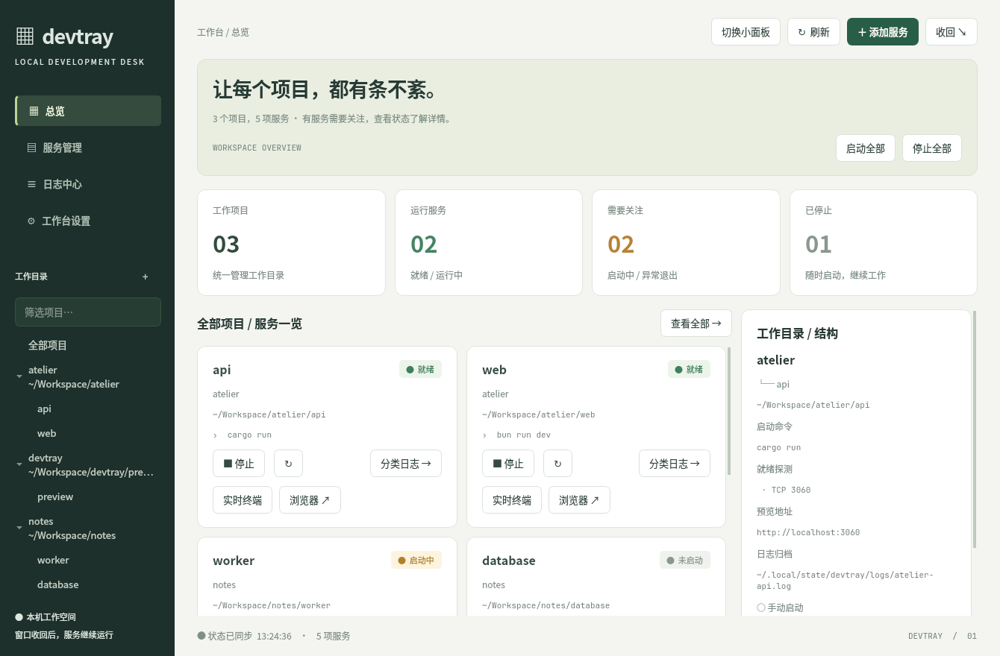

# devtray

**快速启动开发项目，让 Agent 帮你运行，也让开发者随时看得见日志。**

[English](README.md) · [配置示例](examples/config.toml) · [更新日志](CHANGELOG.zh-CN.md)

devtray 是一个面向 Linux 的开发服务托盘管理器。把 `cargo run`、`bun run dev`、`npm run dev` 等命令按项目分组，通过桌面面板或 AI Agent 启停，并从同一个地方查看状态、终端和日志。

开发时，Agent 经常把服务留在后台 Shell 中。服务虽然启动了，开发者却不容易找到它、查看错误或自己排查。devtray 把这些服务交给有名字的 tmux 会话托管，再提供可见的桌面入口：Agent 可以帮忙，人也能随时打开日志、复制错误、进入原始终端或重启服务。你可以让 AI 排障，也可以选择自己看。



## 功能

- 小面板、完整控制面板和系统托盘右键菜单。
- 按项目组织多个服务，支持单服务、项目级和全局启停／重启。
- 日志正则或 TCP 端口就绪探测，失败状态和可选桌面通知。
- 日志级别筛选、搜索、跨重启历史、大小轮转、选择复制和导出。
- 一键打开原始 tmux 终端、项目目录和浏览器预览。
- CLI 和内置 stdio MCP 服务，与桌面端共用服务管理逻辑。

服务和日志采集器运行在 tmux 中。隐藏面板、退出托盘或重启 devtray，不会停止它们。但系统重启，以及会终止用户进程的注销操作，仍可能结束服务。

**v0.1.1 面向 Linux。** 目前界面与命令行提示主要为中文，README 提供中英文版本；本版本没有原生 macOS／Windows 应用。

## 依赖

| 依赖 | 用途 |
| --- | --- |
| `tmux` 和 POSIX Shell（`sh`） | 服务启停与托管，CLI／MCP 同样需要 |
| D-Bus 会话及支持 StatusNotifierItem／AppIndicator 的托盘宿主 | 系统托盘；桌面或状态栏需要提供 SNI 支持 |
| Python 3 + `PySide6`（`QtWidgets`、`QtNetwork`） | 小面板和完整桌面面板；建议 Python 3.10+ |
| 终端模拟器 | 打开交互式 tmux 终端 |
| `xdg-open`（`xdg-utils`） | 打开预览网址和项目目录 |
| `notify-send` | 可选，用于失败桌面通知 |
| `yad` | 可选，用于托盘／CLI 的服务编辑表单；Qt 面板自带表单 |
| Rust stable、Cargo 和 C 链接器 | 从源码构建；v0.1.1 本地验证使用 Rust 1.97.1 |
| 项目自身的运行时和依赖 | 配置命令实际需要的 Rust、Node.js、Bun、Python 等 |

CLI／MCP 服务管理不依赖托盘、Python 或 Qt。devtray 不负责安装业务项目的依赖。Rust 依赖由 [Cargo.lock](Cargo.lock) 固定；没有 Node.js 前端构建步骤，也不需要前端开发服务器。Python 界面源码和生成好的托盘图标内嵌在 Rust 二进制中。

系统依赖安装示例：

```bash
# Debian / Ubuntu（Rust 请另用 rustup 安装）
sudo apt update
sudo apt install build-essential tmux dbus xdg-utils libnotify-bin python3 python3-venv

# Arch Linux
sudo pacman -S --needed base-devel rust tmux dbus xdg-utils libnotify python pyside6
```

发行版没有提供 PySide6 时，可以使用虚拟环境：

```bash
python3 -m venv "$HOME/.local/share/devtray/venv"
"$HOME/.local/share/devtray/venv/bin/pip" install PySide6
export DEVTRAY_PYTHON="$HOME/.local/share/devtray/venv/bin/python"
```

命令行启动时，将 `DEVTRAY_PYTHON` 写入 Shell 配置；systemd 启动时，另按后文加入服务环境。Qt 仍需要可用的 Wayland／X11 环境及对应系统库，Python 虚拟环境不会替代桌面依赖。

## 安装与启动

### 从源码安装

```bash
git clone https://github.com/luisifa/devtray.git
cd devtray
./scripts/install-local.sh
export PATH="$HOME/.cargo/bin:$PATH"

# 立即启动托盘，并在以后登录时启动
systemctl --user enable --now devtray.service

devtray panel --mode full
devtray check
```

安装脚本使用 `Cargo.lock` 构建，并安装程序、图标、桌面启动器和 systemd 用户服务。脚本按 Cargo 默认安装目录 `~/.cargo/bin` 配置服务。首次启动托盘或面板，会生成 `~/.config/devtray/config.toml`，里面的示例默认注释；添加服务前项目列表为空是正常的。

不使用 systemd 时，在图形会话中运行 `devtray`，并将其加入桌面的启动应用。若**只需要 CLI／MCP**，使用 `cargo install --locked --path .`；它只安装二进制，不安装桌面入口或 systemd 单元。首次使用前创建空配置：

```bash
mkdir -p "${XDG_CONFIG_HOME:-$HOME/.config}/devtray"
# 不覆盖已有配置。
touch "${XDG_CONFIG_HOME:-$HOME/.config}/devtray/config.toml"
devtray status --json
```

### 使用发布包

从 [GitHub Releases](https://github.com/luisifa/devtray/releases) 下载对应文件，并使用同一版本的 `SHA256SUMS` 核对校验和。

```bash
# Debian / Ubuntu：apt 会同时处理包依赖
sudo apt install ./devtray_0.1.1-1_amd64.deb

# Fedora / RPM 系统
sudo dnf install ./devtray-0.1.1-1.x86_64.rpm

# 两种包安装后均执行
mkdir -p "$HOME/.local/state/devtray"
systemctl --user daemon-reload
systemctl --user enable --now devtray.service
```

也可以解压 Linux tar 包，将 `devtray` 放入 `PATH` 中的目录。tar 包附带文档和桌面资源，但不会自动安装它们。所有安装方式都需要另行安装可选的 PySide6，才能使用面板。若之前从源码安装过，用户目录中的单元优先于系统包单元；用 `systemctl --user cat devtray` 确认实际启动路径。

## 添加项目和服务

**使用完整面板：**进入服务管理，点击「添加服务」，填写项目名、服务名、工作目录和启动命令。填写新项目名会创建项目，填写已有项目名则向其中添加服务。表单先校验再保存，并保留 TOML 注释。

**编辑 TOML：**打开 `~/.config/devtray/config.toml`，参考 [examples/config.toml](examples/config.toml)。下面的路径必须替换为本机已经存在的项目目录：

```toml
[settings]
poll_ms = 2000
notify = true
notify_debounce_s = 60
# terminal = "kitty"

[[project]]
name = "my-app"

[[project.service]]
name = "backend"
cwd = "~/Workspace/my-app/backend"
cmd = "cargo run"
autostart = false
ready = "Listening on"
port = 3000
url = "http://localhost:3000/"
[project.service.env]
RUST_LOG = "debug"

[[project.service]]
name = "frontend"
cwd = "~/Workspace/my-app/frontend"
cmd = "bun run dev"
ready = "ready in"
url = "http://localhost:5173/"
```

添加另一个项目，就追加一段 `[[project]]`；同一项目的多个服务，使用多段 `[[project.service]]`。建议项目／服务标识使用 ASCII 字母、数字、短横线和下划线，避免转换成 tmux 会话名后发生冲突。

| 字段 | 含义 |
| --- | --- |
| `name` | 必填，项目／服务标识；完整目标名为 `项目/服务` |
| `cwd` | 必填且必须存在；建议绝对路径或 `~/...` |
| `cmd` | 必填；在 tmux 中通过 `sh -lc` 执行 |
| `autostart` | 默认 `false`；托盘启动时，若服务未运行则自动启动 |
| `ready` | 可选，匹配该服务 tmux 输出的正则表达式 |
| `port` | 可选，本机 TCP 端口探测；与 `ready` 是**或**关系，任意通过即就绪 |
| `url` | 可选，浏览器预览地址；未配置时先从日志识别，再按 `port` 拼接 |
| `env` | 可选，该服务的环境变量表 |
| `log_file` | 可选，自定义独立日志文件；相对路径基于 `cwd`，不同服务不能共用 |

托盘自动重载配置，遇到非法配置时保留上一份可用配置。CLI／MCP 每次读取文件，非法时返回错误。修改运行中服务的命令或环境变量后，需要重启该服务；修改文件本身不会触发服务重启。`ready` 通常比 `port` 更准确，因为端口可能被另一个进程占用。

## 日常使用

左键托盘打开／收回上次选择的面板，首次默认为小面板；右键打开系统原生菜单。小面板底部和完整面板顶部可以切换模式，选择会被记住。关闭窗口或按 Esc 只是隐藏面板，服务继续运行。


```bash
devtray                          # 启动托盘
devtray panel --mode full         # 打开完整面板并记住选择
devtray panel --mode small        # 打开小面板并记住选择
devtray panel --toggle            # 展开／收回
devtray panel --target my-app/backend  # 直接查看服务日志
devtray panel --quit              # 退出界面进程，不停止服务

devtray status
devtray status --json
devtray start my-app/backend
devtray restart my-app/frontend
devtray stop my-app/backend
devtray terminal my-app/frontend  # 在终端模拟器中 attach 原始会话
devtray open my-app/frontend      # 浏览器预览
devtray edit my-app/backend       # yad 表单；缺少 yad 时回退到编辑器
devtray help
```

目标可以使用 `项目/服务`、唯一的服务名或 tmux 会话名（如 `devtray-my-app-backend`）。**`start` 会重建已有会话，包括正在运行的服务。** 调用前先查看状态，有意重启时使用 `restart`。停止时先发送 Ctrl-C，最多等待三秒，再删除会话。在 tmux 终端按 `Ctrl-b`，再按 `d`，即可离开终端而不停止服务。

| 机器状态 | 含义 |
| --- | --- |
| `not_started` | 没有对应 tmux 会话；stop 删除会话后也显示此状态 |
| `running` | 进程存活，未配置就绪探测 |
| `starting` | 进程存活，等待就绪探测通过 |
| `ready` | 就绪探测已通过 |
| `exited_ok` | 进程以 0 退出，保留终端 pane |
| `exited_failed` | 进程以非零码退出，保留终端 pane |
| `exited_signal` | 保留的 pane 记录为信号退出 |

托盘以绿色表示运行／就绪，黄色表示启动中，红色表示失败或配置错误，灰色表示未运行。就绪状态在同一 pane 生命周期内锁存，不会因为启动日志滚走就退回「启动中」。v0.1.1 尚无持续健康检查或服务崩溃自动重启。

## 自己查看和排查日志


```bash
devtray logs my-app/backend -n 200
devtray logs my-app/backend --level warn,error
devtray logs my-app/backend --level info --search request
devtray logs my-app/backend --history --level error
devtray logs my-app/backend --run 1 --json
```

日志默认存放在 `${XDG_STATE_HOME:-~/.local/state}/devtray/logs/`。每个服务保留当前 `.log` 和最多十份归档，`.log.1` 最新。重启或单文件达到约 10 MiB 都会归档。通常每服务占用约 110 MiB，允许少量写入块余量；旧版本遗留的大文件可能超过这个值。归档编号随轮转变化，不是固定的运行 ID。

级别支持 `trace`、`debug`、`info`、`warn`、`error`、`other`；搜索不区分大小写。查询先筛选再取最新匹配行，每个文件最多扫描末尾 2 MiB。CLI 最多返回 10,000 行，MCP 最多 5,000 行，面板最多显示 2,000 行。更早的内容可以直接读取原始文件；结构化日志查询会返回截断信息。

在面板中拖选文字或向上滚动，会暂停刷新；需要时点击继续实时刷新。导出保存当前显示的筛选结果。服务停止或崩溃后仍能读取日志。原始 tmux 终端作为独立入口保留，devtray 不修改全局 tmux 快捷键。

## 通过 MCP 与 Agent 协作

Agent 把 **`devtray mcp`** 作为本地 stdio 子进程启动。无需 HTTP 服务、监听端口或单独守护进程，也不要求托盘正在运行。Agent 与桌面程序应使用同一个 Unix 用户和配置文件，才能看到同一批服务；运行环境需要允许访问 tmux 的本地 socket、项目目录和日志。

Codex 注册示例（也可用 `codex mcp add --help` 查看本机语法）：

```bash
codex mcp add devtray -- "$HOME/.cargo/bin/devtray" mcp
codex mcp list
```

其他支持 stdio MCP 的客户端，可以按自身格式配置：

```json
{
  "mcpServers": {
    "devtray": {
      "command": "/home/YOUR_USER/.cargo/bin/devtray",
      "args": ["mcp"],
      "env": {
        "DEVTRAY_CONFIG": "/home/YOUR_USER/.config/devtray/config.toml"
      }
    }
  }
}
```

发行版安装包通常使用 `/usr/bin/devtray`，其他安装方式用 `command -v devtray` 确认绝对路径。替换 `YOUR_USER`；JSON 中的 `~`、`$HOME` 不会自动展开。注册后重新连接或重载 MCP 客户端。客户端设置可参考 [Codex 官方 MCP 文档](https://developers.openai.com/codex/mcp/)。

| 工具 | 参数 | 用途 |
| --- | --- | --- |
| `devtray_status` | 无 | 列出服务、机器状态、命令、日志路径和预览 URL |
| `devtray_logs` | `target`；可选 `lines`、`level`、`search`、`history` | 读取当前或历史日志，默认 80 行 |
| `devtray_start` | `target` | 启动／重建服务，并返回新状态 |
| `devtray_stop` | `target` | 停止服务 |
| `devtray_restart` | `target` | 停止后重新启动 |
| `devtray_open_preview` | `target` | 在用户桌面打开预览网址 |

建议流程：**先查状态 → 必要时启动 → 等待并复查就绪状态 → 失败时读取日志**。启动调用成功只表示已发起运行，不表示编译和启动已经结束。MCP 状态结果可能附带 `advice`，说明服务还在启动或建议查看错误日志。CLI 的 JSON 状态结果包含 `services`，人类可读输出会在需要时附带建议。

可以这样对 Agent 说：

> 用 devtray 启动 my-app 的后端和前端。先查状态，已运行的服务不要重复启动。等待就绪，启动失败就看错误日志。我会在桌面面板里查看同一份日志。

不支持 MCP 的 Agent，也可使用 `devtray status --json` 和前面的 CLI。可以把下面这段加入业务项目的 `AGENTS.md`：

```text
通过 devtray（MCP 或 CLI）管理长期运行的开发服务。
启动前先查看状态；devtray start 会重建已有会话。
让开发服务留在 devtray 中，方便开发者查看终端和日志。
服务仍在 starting 时，等待并复查，不要立即判定失败。
用 devtray logs 排障；仅在任务需要时停止或重启服务。
添加服务通过 devtray 配置或界面完成；MCP 没有添加服务工具。
```

## 构建、打包与跨平台说明

| 平台 | v0.1.1 支持情况 |
| --- | --- |
| Linux x86_64 | 主要验证平台；支持 GNU 和 musl 构建 |
| Linux ARM64 | 提供源码／交叉编译步骤，需在目标桌面实际验证 |
| Windows | 无原生版本；可在 WSL2 内运行 Linux CLI／MCP。面板／托盘还需要合适的 Linux 桌面环境，尚未验证 |
| macOS | 不提供受支持的原生构建；本版本可在 Linux 虚拟机中使用 |

目前实现依赖 SNI／D-Bus、tmux、`/proc`、`xdg-open`、Unix socket 和 Linux 桌面集成。仅添加 Rust target 不会自动获得 Windows／macOS 原生支持。WSL／虚拟机内的 devtray 管理的是该环境内的服务，而非宿主系统原生进程。

### Linux 原生构建

通过 [rustup](https://rustup.rs/) 安装当前稳定版 Rust，并安装发行版的 C 构建工具：

```bash
cargo build --release --locked
./target/release/devtray --version

# 仅制作安装包时需要这些打包工具
cargo install cargo-deb --locked
cargo install cargo-generate-rpm --locked
rustup component add rust-docs
python3 scripts/generate-third-party-notices.py --target "$(rustc -vV | sed -n 's/^host: //p')"
cargo deb --no-build --locked                 # 输出到 target/debian/
cargo generate-rpm                          # 输出到 target/generate-rpm/
```

GNU/Linux 二进制建议在计划支持的最老发行版上构建，较新 glibc 环境构建的程序可能无法在旧系统运行。本版本发布使用的静态 Linux 可执行文件可这样构建：

```bash
rustup target add x86_64-unknown-linux-musl
cargo build --release --locked --target x86_64-unknown-linux-musl
cargo deb --no-build --locked --target x86_64-unknown-linux-musl
cargo generate-rpm --target x86_64-unknown-linux-musl

# 生成所有发布产物及 SHA256SUMS，输出到 dist/
./scripts/package-release.sh
```

发布包的运行库许可快照按 Rust 1.97.1 核查；复现发布包请使用该工具链。升级打包工具链时，需要重新检查 musl／LLVM 的许可快照。

静态 Rust 二进制仍需要运行时的 tmux，以及面板使用的 Python／Qt。已生成的图标随源码提供，普通构建不需要重新生成；修改图标后执行 `scripts/build-icons.sh`，另外需要 `rsvg-convert` 和 PySide6。

### 从 Linux x86_64 交叉编译 Linux ARM64

Debian／Ubuntu 示例：

```bash
sudo apt install gcc-aarch64-linux-gnu binutils-aarch64-linux-gnu
rustup target add aarch64-unknown-linux-gnu
CARGO_TARGET_AARCH64_UNKNOWN_LINUX_GNU_LINKER=aarch64-linux-gnu-gcc \
  cargo build --release --locked --target aarch64-unknown-linux-gnu
```

输出为 `target/aarch64-unknown-linux-gnu/release/devtray`。复制到 ARM64 Linux 机器后，安装运行时依赖，再验证 CLI、系统托盘和 Qt 面板。PySide6 要安装在**目标机器**上。该流程不等于移植到 macOS／Windows。Rust 官方的[交叉编译说明](https://rust-lang.github.io/rustup/cross-compilation.html)介绍了 target 和链接器的关系。

### 验证

```bash
cargo fmt --all -- --check
cargo test --locked
cargo clippy --locked -- -D warnings
cargo build --locked
python3 tests/mcp.py
QT_QPA_PLATFORM=offscreen python3 tests/test_panel.py
python3 tests/panel_instance.py
python3 tests/log_restart.py
python3 tests/launch_shortcuts.py
dbus-run-session -- python3 tests/tray_context_menu.py
```

集成测试使用临时配置和隔离的 tmux／D-Bus 会话，需要本地 socket 和伪终端权限；托盘测试还需要 Python PyGObject（`gi`，例如 `python3-gi`）。请在允许这些操作的 Linux 环境运行。CI 检查 Rust、Qt、MCP 与集成行为。架构说明见 [docs/control-panel.md](docs/control-panel.md)。

## 排障与路径

```bash
devtray check
systemctl --user status devtray.service
systemctl --user cat devtray.service
tail -n 100 "$HOME/.local/state/devtray/service.log"
```

附带的 systemd 单元将 devtray 自身 stdout／stderr 重定向到 `service.log`；`journalctl --user -u devtray.service` 可查看 systemd 生命周期事件。业务服务日志在独立的 `logs/` 目录下。

- **命令找不到／exit 127：**systemd 环境与交互 Shell 可能不同。使用可执行文件绝对路径，或通过 `systemctl --user edit devtray.service` 补充运行时目录。
- **PySide6 不可用：**在 Shell 和 systemd 服务环境中分别配置 `DEVTRAY_PYTHON`，指向安装了 PySide6 的解释器。
- **托盘图标不出现：**确认图形会话有 D-Bus，以及 SNI／AppIndicator 托盘宿主；Qt 面板和 CLI 可以独立使用。
- **安装后仍显示旧版本：**执行 `systemctl --user restart devtray.service`；用 `devtray panel --quit` 退出旧面板后重新打开。已有服务的命令和日志采集器直到服务重启才更新。
- **重启托盘导致服务退出：**保留单元中的 `KillMode=process`，避免 systemd 连同 tmux 进程一起结束。
- **无桌面 CLI／MCP：**先手动创建配置，`check` 不会生成模板。打开浏览器等桌面功能仍需要图形会话。

systemd 覆盖配置示例（替换 Python 路径）：

```ini
[Service]
Environment=DEVTRAY_PYTHON=/home/YOUR_USER/.local/share/devtray/venv/bin/python
Environment=PATH=%h/.bun/bin:%h/.cargo/bin:%h/.local/bin:/usr/local/bin:/usr/bin:/bin
```

修改后运行 `systemctl --user daemon-reload` 和 `systemctl --user restart devtray.service`。保留 `Restart=on-failure`，避免主动退出托盘后又被立即拉起。

| 环境变量 | 含义 |
| --- | --- |
| `DEVTRAY_CONFIG` | 覆盖完整配置文件路径 |
| `XDG_CONFIG_HOME` | 配置根目录，默认 `~/.config` |
| `XDG_STATE_HOME` | 日志／状态根目录，默认 `~/.local/state` |
| `DEVTRAY_PYTHON` | 运行内嵌 Qt 面板的解释器，默认 `python3` |
| `TERMINAL` | 未配置 `settings.terminal` 时优先选择的终端 |

v0.1.1 不提供服务依赖编排、崩溃自动重启、CPU／内存监控、远程多用户控制或已有 systemd 服务纳管；定位是本地开发助手。

## 许可

devtray 自有源码、文档及项目自制资源采用 [MIT 许可证](LICENSE)。Copyright (c) 2026 ferychen。

第三方组件保留各自许可证，详见 [THIRD_PARTY_NOTICES.md](THIRD_PARTY_NOTICES.md) 和 [licenses/](licenses/README.md)。可选的 PySide6／Qt 界面使用用户另行安装的 LGPLv3 库；本发布包不捆绑 Python、PySide6 或 Qt。

安装包包含项目许可证、依赖许可声明、适用的 Unicode 声明、Rust 标准库声明及 musl 版权信息。构建目标后，可执行 `python3 scripts/generate-third-party-notices.py --target x86_64-unknown-linux-musl` 重新生成声明；打包脚本会自动执行。
