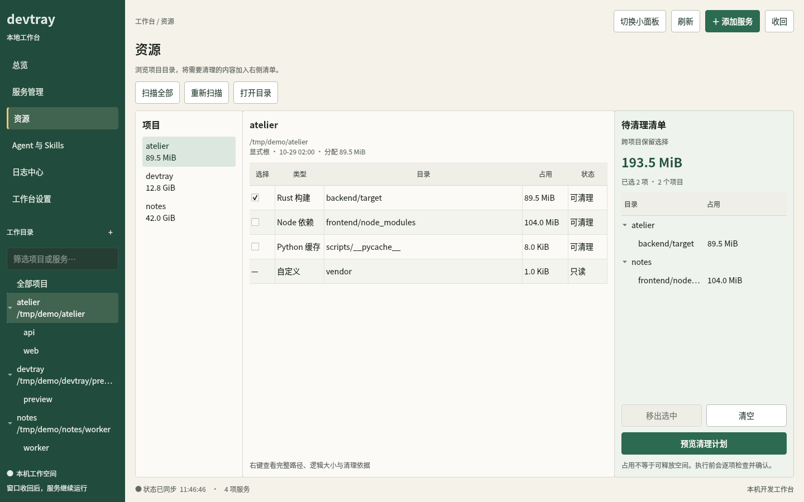
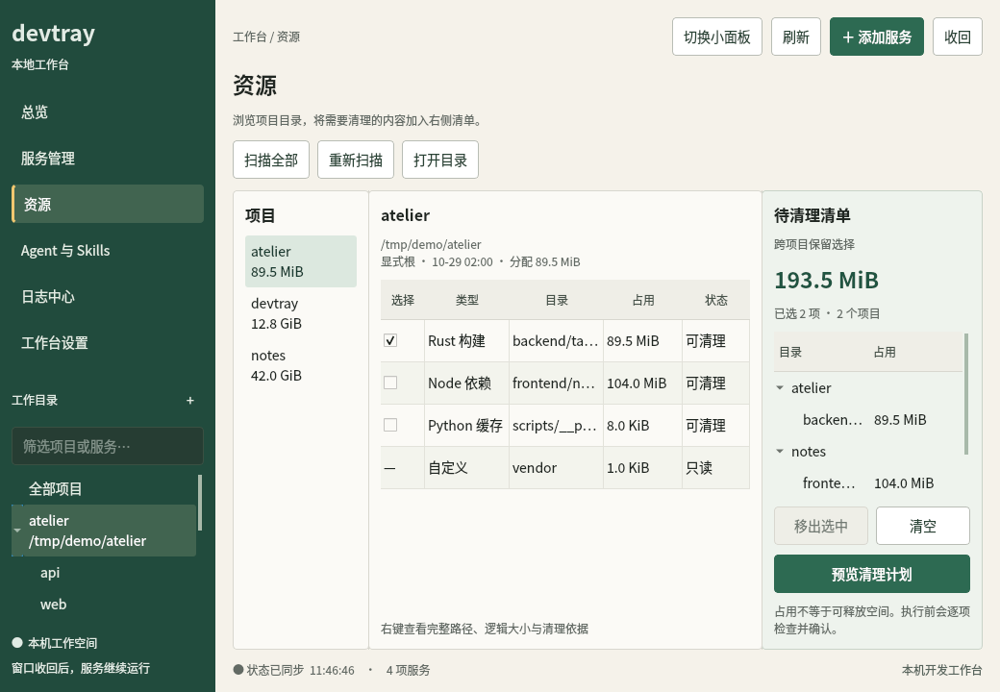
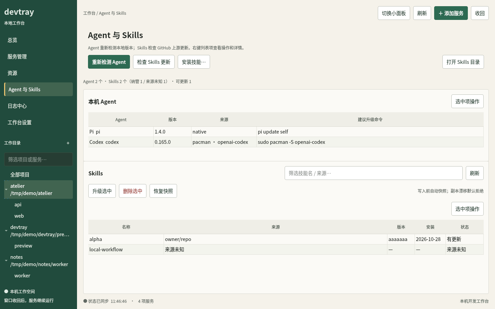
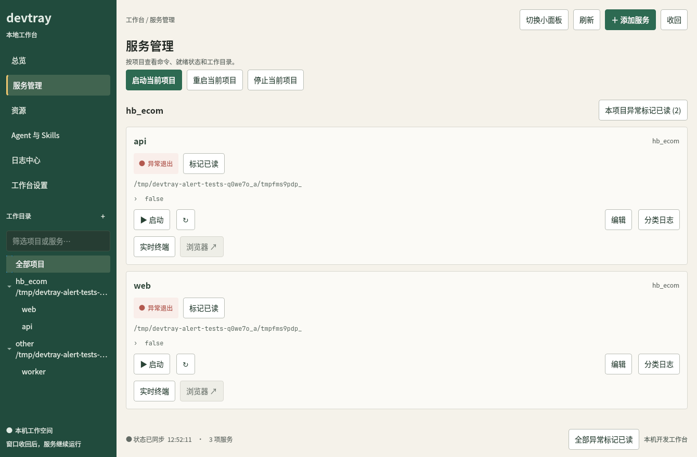

# devtray 控制面板设计

当前功能与验证结果见 [开发状态（2026-10-29）](development-status.md)。

> 2026-10-28 更新：侧栏新增「资源」与「Agent 与 Skills」页，总览增加一行资产摘要；
> 导航顺序变为 总览 / 服务管理 / 资源 / Agent 与 Skills / 日志中心 / 工作台设置，
> 日志页索引顺延为 4。Agent 与 Skills 展示版本、来源与 lock 对账，并支持 Skills 写操作；副本状态在详情里查看。
> 资源页只消费 `_disk-cache`、`_disk-scan`、`_clean-plan`、`_clean-start`、`_job`，删除仍走
> 六项检查与 job，不在 UI 里另开写路径。MCP 的 `devtray_clean` 复用同一 job 与 `_approve`
> 审批进程；面板与 Agent 不会各自实现一套删除逻辑。Skills 表的「升级选中 / 删除选中」
> 复用 `_skills-plan` / `_skills-start` / `_skills-run`，写入前快照、漂移默认拒绝；
> 「恢复快照」通过 `_skills-backups` / `_skills-restore` 选择最近 3 份，默认不改 lock。

## 信息结构

首页总览 → 项目工作目录 → 服务卡片 → 运行结构 / 日志。左侧深松绿色导航承担长期的管理模块入口，
主内容采用暖白卡片，绿 / 黄 / 红分别表示正常、启动中与失败，并同时提供文字状态。
较窄窗口中服务卡片自动切为单列；服务列表和详情独立滚动，窗口最小支持 1040 × 720。

总览展示全局统计；选中项目后限制服务卡片和批量操作范围，按钮明确区分“全部”和“当前项目”。
日志服务选择独立于项目筛选，可以跨项目排查。状态刷新不会重置用户的项目选中、日志搜索或窗口页面。

服务表单复用 Rust `form` 模块：先校验再落盘、保留 TOML 注释、无修改时保持原始字段写法。
UI 通过 QProcess 异步调用同一个二进制，动作执行期间不会阻塞窗口，也不暴露本地 HTTP 控制端口。

## 同类工具中采用的做法

| 工具 | 可参考能力 | 在 devtray 中的实现 |
|---|---|---|
| [ServBay 服务管理](https://support.servbay.com/basic-usage/services-and-packages/service-and-package-management) | 首页集中显示状态和启停、统一日志入口 | 总览卡片、全局 / 项目操作、服务卡片直达日志 |
| [ServBay 网站管理](https://support.servbay.com/basic-usage/websites/website-management-panel) | 从项目进入配置、预览和日志 | 左侧项目工作目录，右侧命令 / 探活 / 预览 / 日志结构 |
| [lnav](https://lnav.org/features) | 日志过滤和保存会话状态 | 级别多选、文本搜索、保存筛选条件、历史文件选择；大范围分析可直接交给 lnav |
| [tmux 的复制行为](https://github.com/tmux/tmux/wiki/Getting-Started) | 鼠标松手默认复制并退出复制模式 | 默认日志入口改为 Qt 只读文本区，保留独立交互终端入口 |

ServBay 的多运行时安装器和 lnav 的 SQL 分析没有移植进来；本次优先做项目管理和可读、可留存的日志。

## 根因与修复

1. **重启后日志消失**：`tmux::start` 每次 `File::create` 截断文件。真实 tmux 测试先观察到旧 WARN
   消失，再验证新版重启归档、过滤历史、停止后查询都通过。
2. **无法按级别筛选**：原日志读取仅截取文本尾部。现在 Rust `logs` 模块统一去 ANSI、识别级别、
   按级别 / 文本过滤后取尾部；CLI、MCP、Qt 共享该逻辑。
3. **拖选松手后高亮取消**：本机 tmux 鼠标开启，两个 copy-mode 键表都是 `copy-pipe-and-cancel`。
   Qt 面板用 QPlainTextEdit 独立浏览日志，在按下鼠标前暂停刷新；迟到的异步请求也不得改动选区。
4. **长期运行磁盘增长**：采集器按大小轮转；每服务只保留 10 份归档。采集器由 tmux 托管，
   关闭面板和重启托盘不影响采集。读取采用有界扫描和有界条目队列。

## 代码边界

- `src/logs.rs`：日志落盘、轮转、级别识别和查询；无需数据库服务器。
- `src/panel.rs`：打包 Qt 脚本、启动面板、结构化配置接口。
- `ui/panel.py`：Qt 窗口、导航、表单、日志视图；按配置路径隔离单实例和界面偏好。
- `ui/quick_menu.py`：深松绿卡片式快捷菜单，项目折叠、搜索、状态与启停入口；复用面板异步命令层。
- `src/tray.rs`：左键切换记忆模式的面板，右键原生菜单；终端、浏览器和分类日志入口并存。使用上游 ksni。
- `tests/log_restart.py`：独立 tmux 后端端到端回归。
- `tests/test_panel.py`：真实 CLI + Qt 拖选、筛选、表单和隐藏窗口回归。
- `tests/panel_instance.py`：真实进程与本地 socket 的展开 / 收回、单实例和退出回归。
- `tests/tray_context_menu.py`：独立 D-Bus 会话中验证原生右键菜单和左键记忆模式。
- `tests/launch_shortcuts.py`：独立 tmux 服务和真实 PTY 验证原始终端 attach、保留退出屏幕、PID 不变、浏览器 URL 调用。

快捷菜单使用 430 px 宽的无边框 Qt 工具窗口，屏幕内高度最多 720 px；项目区域独立滚动。
首次自动收起全部停止的项目，手动折叠状态随配置保存；搜索暂时展开命中的服务。
状态刷新仅更新现有行，配置结构改变时才重建卡片，避免刷新打断按钮焦点。
默认固定显示；取消固定后失去焦点收回，固定偏好写入 QSettings。Esc / 关闭 / 再次左键始终可收回。
标题通过 `QWindow.startSystemMove()` 拖动，支持 Wayland；固定宽高使 niri 自动识别为浮窗。
隐藏后停止浮窗轮询；进入面板时收回浮窗。X11 同一进程内重新打开保留拖动位置。
Wayland 通常由合成器决定顶层窗口位置，无法保证菜单紧贴托盘图标。

因此右键恢复由桌面定位的原生菜单；左键打开记忆模式。小面板底部 / 完整面板顶栏显式切换时保存
`panel_mode=small|full`，首次默认 small。临时进入日志 / 设置不覆盖偏好；CLI `panel --mode` 与界面共用此流程。

入口回归的根因：小面板只迁移了启停和分类日志，遗漏了原菜单里的终端及预览；总览卡片也未提供预览，
仅服务管理页具备该入口。现有 tmux 输出和文件日志并未丢失。修复后两种卡片统一提供实时终端、浏览器、
分类日志，日志中心可直达当前服务终端。终端入口对保留的已退出 pane 同样可用，不会重启服务。

当前留存为文件 + 查询时解析。SQLite 可在需要跨服务时间检索、日志书签或更大规模全文查询时
作为派生索引加入；原始归档仍应保留为可独立读取的数据源。

后续模块建议依次为：资源监控（CPU / 内存 / 端口占用）、数据库快捷入口、定时任务。
依赖拓扑、故障自动重启等涉及进程监管，应单独明确策略再实现。现有“结构”展示的是实际配置关系，
不将尚不存在的服务依赖画成真实拓扑。

## 2026-10-29 交互修复与设计初稿

- 资源扫描路径是项目相对路径；面板清理前以该项目 root 拼成绝对路径，后端围栏与门禁继续复查。
- 完整/小面板「清除提示」发 `_dismiss-alerts`，托盘按配置文件隔离读取信号。只确认当前失败进程和当前配置错误；保留退出码、日志与服务状态，新进程失败重新提示。托盘右键也有同一语义的入口。
- 两张列表增加右键菜单和可见的「选中项操作」。Skills 副本列隐藏，详情仍可查看；副本漂移继续阻断默认写操作。
- Agent 重检与 Skills 上游检查分开命名。Agent 检测增补用户 bin 目录、Kimi/Hermes、stderr 版本与每个版本探测两秒上限。自动 Skills 安装仅选择已有副本校验实现的 Agent。
- 总览移除项目批量启动/停止按钮，服务管理保留。
- 三列资源初稿在 `design-demos/`；用户已选择松绿色A方向并落实Qt布局，初稿仍独立保留。

验证：69 项 Rust、15 项 Qt；`interaction_fixes.py` 覆盖桌面PATH、stderr版本、面板绝对路径、后端计划/越界拒绝与确认信号；既有资源页、Agent/Skills、更新、安装/恢复、MCP回归通过。浏览器原型截图与验证报告另存于 design-demos。

### 方向选择补充：保留全局项目导航

用户选择A松绿色方案，并明确要求保留最左侧原有项目列表。全局sidebar中的项目/服务树、搜索和折叠是长期导航，资源页内部项目列承担资源浏览，两者都保留。修订初稿dir-1.html实现全局项目与资源当前项目同步、跨页面保留导航、筛选项目/服务与跨项目清理选择。正式Qt面板原有`self.tree`不删除。

## 松绿色方案落地（2026-10-29）

用户确认采用修订后的A方案，并要求浅色方向C留作备用。运行时继续采用松绿色主题；浅色HTML初稿保留在`design-demos/dir-3.html`。

- 全局项目/服务树、项目与服务搜索继续保留。选择项目不跳走当前页面，资源项目与全局选中同步；展开/收起偏好按配置保存，搜索结束后恢复原来的折叠状态。
- 资源页采用三列：项目、扫描目录、待清理清单。选择以项目和相对路径为键，跨项目/页面保留。右侧按项目分组，支持移出与清空；这两个动作只改选择。
- 新扫描会更新选择的占用；目录消失、根目录变化、证据失效或扫描不完整时，该项目的不安全选择失效。完整路径、逻辑大小、文件数和清理证据放在行详情。
- 点击「预览清理计划」后，先对所有选中项目逐项检查，再统一列出目录供用户确认。确认后按项目串行创建清理任务；任何失败（包括done结果里的部分失败）停止后续项目，保留未完成选择。可在执行中停止后续项目，当前任务继续完成。
- 后端的路径围栏、运行状态检查、文件锁和审计继续生效。查询任务暂时失败不会释放写入状态；保留job id并重试，避免重复提交。清理预检与Skills写操作共用界面互斥。
- 主题、资源UI与选择模型分别位于`ui/panel_theme.py`、`ui/resource_panel.py`、`ui/resource_selection.py`。Rust内嵌这些模块，经stdin交给Python，避免单条命令参数的长度限制。

验证：70项Rust单测、原有15项Qt回归、新增12项资源工作区回归，以及资源/Skills/MCP、真实面板启动和单实例、tmux与托盘集成。CI已加入新增专项回归。实际Qt截图（隔离演示数据）：

## 服务异常已读修复（2026-10-29）

`hb_ecom/web` 的保留退出状态暴露了两个缺口：原「清除提示」按钮只有顶部提示出现时才显示；原托盘已读信息只存在于内存，重启后丢失。现已在总览/服务管理卡片、小面板服务行、托盘服务子菜单增加「标记已读」，面板底部提供独立的全部已读入口。

`devtray ack <项目/服务>` 将当前异常的退出码与pane PID作为运行标识保存到`state/alerts/<config-hash>.json`。配置路径隔离、文件锁和原子写避免多个界面相互覆盖；CLI、Qt、托盘共同读取。UI提交捕获的运行标识，服务若已重启并再次失败则拒绝过期确认。原退出状态、终端屏幕和日志不变，已读异常只从未读告警与托盘红色状态中移除；重启托盘后仍然有效。

验证：`tests/service_alerts.py` 用真实CLI与Qt、隔离tmux快照覆盖无banner入口、小面板入口、跨进程持久记录、新失败重报、过期确认拒绝及服务间隔离。Rust覆盖托盘重新加载已读记录后恢复图标，并保留真实失败状态。

## 项目与日志中心异常处理（2026-10-29）

沿用已确认的松绿色工具台与全局项目树。服务卡片将「标记已读」放到异常状态旁，右侧服务详情也显示异常退出码与已读入口。选中项目的总览，以及服务管理的各项目标题，增加「本项目异常标记已读」，严格按该项目当前失败的运行标识逐条确认，不清除其他项目的异常。

日志中心采用可调整高度的上下分区：上方为异常处理列表，下方保留文件日志浏览。列表展示项目、服务、异常退出码、未读／已读状态，以及「查看日志」「标记已读」按钮；支持独立的项目和处理状态筛选，点击侧栏项目时同步筛选。已读行保留并禁用重复确认，新失败重新变为未读。列表只列出 tmux 当前保留的异常退出，不把日志中的 ERROR 行或已经消失的运行伪装成历史事件。

所有按钮调用同一 `ack` 接口并携带捕获的 failure token；项目操作逐条处理并展示错误。标记已读只刷新状态和列表，不重置日志筛选、暂停和文字选区。若确认时已有旧的状态请求在执行，完成该请求后再读取一次状态，防止旧响应让界面停留在未读。

- `ui/service_alert_panel.py`：异常列表、项目范围操作与公共已读按钮，随二进制内嵌。
- `tests/service_alerts.py`：真实 CLI + Qt 验证项目隔离、列表筛选、日志定位、暂停选区保留、过期确认、新失败重现与状态刷新竞争。

以下截图使用隔离演示数据：

