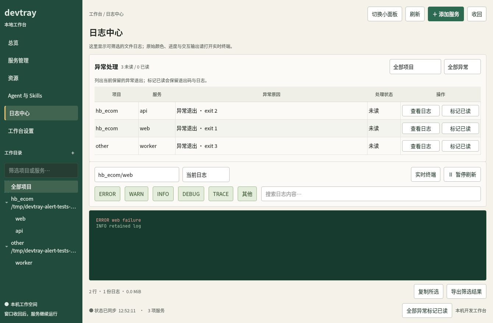

# devtray 开发状态

更新时间：2026-10-29。此文记录本轮开发完成后的源码状态，供下一期需求和验收使用。

当前公开发布版本为 **v0.1.1**；本轮功能记录在双语 CHANGELOG 的 **Unreleased／未发布** 中。设计文档中的 v0.2／v0.3 是功能阶段划分，资源和 Skills 的主要功能已实现，正式版本号仍待下次发布确定。

## 产品能力

devtray 是 Linux 开发服务工作台。开发者和 AI Agent 共用同一套服务配置与操作底座，通过系统托盘、Qt 面板、CLI 或 stdio MCP 管理 tmux 中的服务，并查看状态、终端和日志。

| 模块 | 已实现功能 | 入口 |
| --- | --- | --- |
| 服务管理 | 按项目组织服务，单项／项目／全局启停与重启，自动启动，日志正则或 TCP 就绪检测，打开工作目录和浏览器预览 | 服务管理、快捷小面板、托盘、CLI、MCP |
| 完整工作台 | 松绿色导航、总览、服务管理、资源、Agent 与 Skills、日志中心、工作台设置；保留全局项目／服务树、搜索和折叠 | 托盘左键、`devtray panel` |
| 日志 | 级别筛选、搜索、历史归档、大小轮转、暂停、拖选复制、导出；可直接打开原始 tmux 交互终端 | 日志中心、服务卡片、`devtray logs` |
| 异常处理 | 服务和项目范围的已读按钮，日志中心异常列表，按项目和未读／已读筛选，逐条查看日志与标记已读；托盘同步解除对应告警 | 面板、快捷小面板、托盘、`devtray ack` |
| 项目资源 | 扫描 `target`、`node_modules`、`.venv` 等目录，区分分配空间与逻辑大小，扫描缓存、资源摘要、打开目录 | 资源页、`devtray disk` |
| 资源清理 | 项目／目录／待清理清单三列，跨项目保留选择、移出和清空、统一预检与确认、串行执行、失败停止后续项目 | 资源页、CLI、MCP |
| Agent 检测 | 检测本地可执行文件、版本、安装来源，展示建议升级命令；补查常见用户安装目录，兼容 stderr 版本输出与超时 | Agent 与 Skills、`devtray agents` |
| Skills | 全局清单、lock 对账、来源和副本状态，GitHub tree SHA 更新检查，安装／升级／删除、操作前快照、快照恢复 | Agent 与 Skills、`devtray skills` |
| Agent 接入 | 九个 MCP 工具，共享服务操作、日志、资源缓存、后台清理与 job 查询 | `devtray mcp` |

服务与日志采集器由 tmux 托管。窗口隐藏以及按附带单元重启托盘时，已有服务继续运行。需要更新业务服务命令或环境时，仍要单独重启对应服务。

## 本轮需求完成情况

| 问题／需求 | 当前结果 |
| --- | --- |
| 异常退出后托盘一直红色，无法确认或取消提醒 | 已提供清除提示、单服务已读、项目已读和全局已读；按配置路径与当前失败进程保存确认记录，重启托盘后仍有效 |
| `hb_ecom/web` 保留异常退出，界面没有明显处理入口 | 服务异常状态旁及详情显示「标记已读」；服务管理的项目标题提供「本项目异常标记已读」 |
| 日志中心需要集中处理异常 | 已加入异常处理列表、项目／处理状态筛选和逐条操作；确认异常时保留日志筛选、暂停状态与文字选区 |
| 旧页面可能确认服务重启后产生的新异常 | UI 携带捕获的运行标识；后端拒绝过期确认，新的一轮失败重新提示 |
| Agent 检测不完整 | 增加用户安装目录搜索、stderr 版本读取、探测超时和 Kimi／Hermes 识别；当前注册表覆盖十类 Agent |
| Agent 和 Skills 列表缺少操作入口 | 两个列表均提供右键与普通操作菜单，支持查看详情、复制路径和已有操作 |
| Skills 副本检测用途不明确 | 主表隐藏副本列，副本和漂移详情放到次级入口；写入时仍使用漂移检查 |
| 两个列表的「检查更新」含义混淆 | 明确区分 Agent 重新检测本地版本和 Skills 检查 GitHub 上游；Agent 显示升级建议，Skills 提供内容树对比 |
| 资源勾选清理出现「解析失败」 | 清理请求使用项目根下的绝对路径，后端继续校验项目范围 |
| 资源勾选布局不合理 | 已采用项目、目录、待清理清单三列，支持跨项目选择和批量计划 |
| 总览的项目启动／停止按钮多余 | 总览移除批量启停；服务管理保留有明确范围的批量操作 |
| 新布局遗漏原来的项目侧栏 | 完整工作台保留全局项目／服务树、搜索与折叠；切换模块仍可使用 |
| 编译后重启仍使用旧程序 | 本机已安装修复后的 release 二进制并重启托盘，关闭旧面板；实际核对运行二进制与六个托管服务进程 |

异常已读会保留真实退出状态、退出码、终端屏幕和日志；当前异常列表展示 tmux 中保留的失败运行。已读记录只适用于对应失败进程，下一次运行失败会重新告警。

## 写操作与后台任务

- 清理候选需通过目录白名单、构建证据、Git 跟踪、项目范围、挂载边界和运行状态检查；计划确认前与执行取锁后重新校验。
- 服务启停和清理等操作使用跨进程锁协调。面板对清理和 Skills 写计划实施互斥，查询任务失败时保留跟踪并重试。
- Skills 写入前枚举受影响路径并建立快照，漂移默认拒绝；执行后校验并记录审计。固定使用已测的 `skills@1.7.4`。
- MCP 清理默认通过桌面审批，返回 job ID 后查询进度与结果。配置支持 `ask`／`deny`／`allow`；界面和 Agent 使用同一执行逻辑。
- Qt 模块内嵌在二进制中，通过 stdin 传递脚本，避免 Linux 单个命令行参数长度限制。

## 验证结果

2026-10-29 在本机 Linux 环境完成 **19 项验证步骤，全部通过**：

| 验证范围 | 结果 |
| --- | --- |
| Rust 格式、编译、Clippy | 通过；Clippy 使用 `-D warnings` |
| Rust 单元测试 | 72 项通过 |
| Qt 面板、资源工作区、异常处理 | 分别 15／12／9 项用例通过，共 36 项 |
| MCP | 握手、九个工具、状态、日志、资源缓存、清理与 job 行为通过 |
| Agent 与 Skills | 清单和来源检测、更新缓存、安装、写门禁、快照与恢复相关集成检查通过 |
| 资源与交互 | 资源渲染、真实后端扫描、清理门禁、路径解析、操作菜单和通知清除检查通过 |
| tmux 与终端 | 首次输出、重启归档、停止后日志、真实 PTY attach 与浏览器分发通过 |
| 嵌入式界面 | 单实例、大小面板切换、模式记忆、隐藏与退出通过 |
| 原生托盘 | 独立 D-Bus 中验证原生菜单、已读后图标恢复、重启保留已读、新失败重新告警 |

网络相关 Skills 集成测试使用可控的 `gh`／`npx` 替身；这些结果不代表已覆盖每种真实远端来源或 Agent 安装方式。资源删除、技能写入及服务启停测试使用临时目录或隔离会话。GitHub Actions 配置已纳入本轮新增回归；正式安装包生成与发布按仓库发布流程执行。

常用验证命令和完整集成脚本列表见 [CI 配置](../.github/workflows/ci.yml)。

## 下一期可继续的工作

1. Agent 在线最新版本查询及来源感知的升级执行；当前只检测本地版本与展示建议命令。
2. 项目级 Skills 管理；当前主要管理全局 Skills 与关联副本。
3. 跨运行的历史异常事件和后台 job 失败统一收件箱；当前异常列表聚焦保留的服务异常退出。
4. 浅色主题运行时切换；方向 C 原型保留备用，当前实现使用已确认的松绿色方向 A。
5. 可选 AI 发现／建议与其他平台支持；当前没有原生 macOS／Windows 应用。

下一期排期前，可基于以上边界补充验收条件；新版本发布时再确定版本号、构建安装包并创建 Release。

## 文档与示例

- [中文使用说明](../README.zh-CN.md)／[English README](../README.md)
- [资产与技能设计](asset-management.md)
- [控制面板与异常处理设计](control-panel.md)
- [仓库管理与发布说明](repository-management.md)
- [已确认的设计方向](../design-demos/direction-approved.md)
- [中文更新日志](../CHANGELOG.zh-CN.md)／[English changelog](../CHANGELOG.md)

