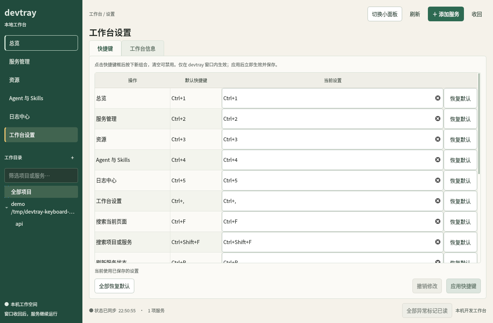
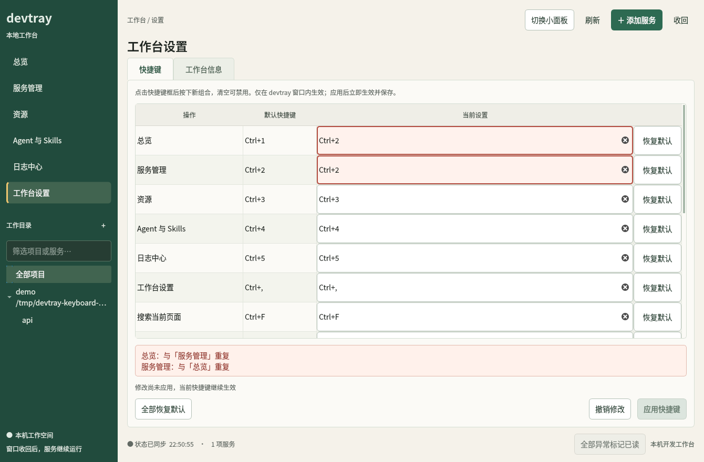
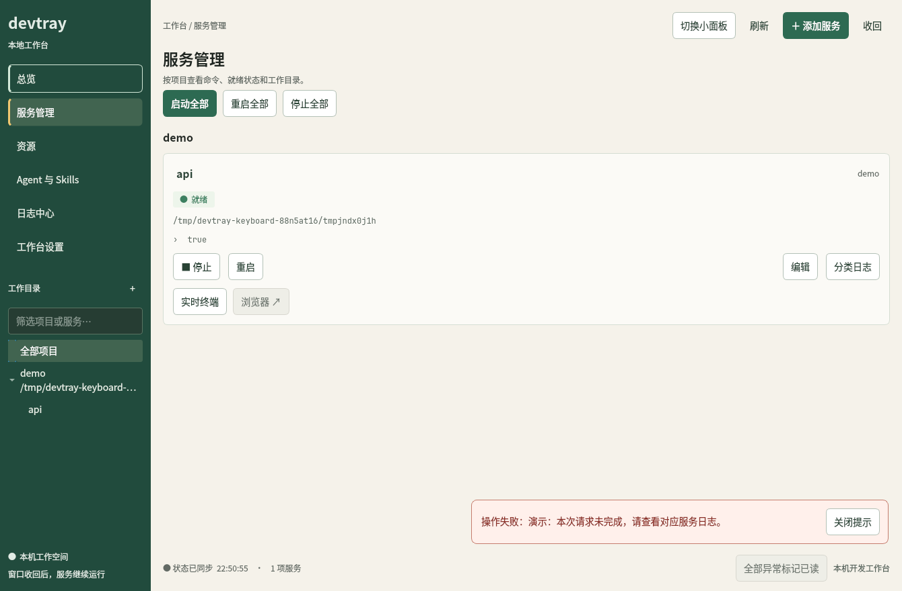

# 快捷键与操作反馈

2026-11-04 更新。沿用已确认的松绿色工作台；快捷键在 devtray 完整面板和快捷小面板内生效。

## 默认方案

| 操作 | 默认快捷键 |
| --- | --- |
| 总览 | `Ctrl+1` |
| 服务管理 | `Ctrl+2` |
| 资源 | `Ctrl+3` |
| Git | `Ctrl+4` |
| Agent 与 Skills | `Ctrl+5` |
| 日志中心 | `Ctrl+6` |
| 工作台设置 | `Ctrl+,` |
| 搜索当前页面 | `Ctrl+F` |
| 搜索项目或服务 | `Ctrl+Shift+F` |
| 刷新服务状态 | `Ctrl+R` |
| 添加服务 | `Ctrl+N` |
| 查看当前服务日志 | `Ctrl+L` |
| 暂停／继续日志刷新 | `Ctrl+Shift+P` |
| 切换大小面板 | `Ctrl+M` |
| 快捷键说明 | `F1` |
| 收回当前面板 | `Esc` |

`Ctrl+1` 至 `Ctrl+6` 按侧栏顺序切换模块，`Ctrl+,` 打开设置。`Ctrl+F` 在日志中心搜索日志、在 Git 页筛选项目、在 Agent 与 Skills 页筛选 Skills，在其他页面搜索项目；小面板中搜索项目与服务。`Ctrl+L` 保留原有日志入口并定位当前服务；`Ctrl+Shift+P` 在日志中心切换暂停状态。F1 展示实际生效的快捷键。

刷新、查找、新增、设置与帮助的默认键参考 [GNOME 标准快捷键](https://developer.gnome.org/hig/reference/keyboard.html)。模块切换、日志和大小面板操作是 devtray 的应用内定义。应用不注册桌面全局快捷键，不改动窗口管理器配置。

## 覆盖默认值

1. 进入「工作台设置 → 快捷键」，点击对应操作的录入框，再按下新组合。
2. 清空录入框可禁用该操作；「恢复默认」只修改该行，「全部恢复默认」修改全部草稿。
3. 修改后点击「应用快捷键」；更改立即作用于大小面板，并按配置路径隔离保存到现有 QSettings 偏好中。
4. 「撤销修改」恢复上一次已保存的映射。未应用的草稿在后台刷新和切换页面时保留。

当前只支持单组按键，例如 `Ctrl+G` 或 `F8`。重复组合、文本编辑保留键和常见桌面保留键会显示具体错误并阻止应用。Super／Meta 留给桌面环境；复制、粘贴、选择、撤销、Tab 焦点移动等继续使用原生行为。快捷键录入期间、模态对话框中和其他应用窗口中，不触发本窗口操作。系统自身已拦截的按键无法在应用内重新分配。

配置键为 `keyboard/overrides_v1`，只保存与默认值不同的映射；空字符串表示禁用。损坏的配置回退为默认值，并在设置页显示提示。实现使用 [Qt QKeySequenceEdit](https://doc.qt.io/qtforpython-6/PySide6/QtWidgets/QKeySequenceEdit.html) 和窗口作用域的 [QShortcut](https://doc.qt.io/qtforpython-6/PySide6/QtGui/QShortcut.html)。

## 边框、按钮和反馈

- 卡片边框降低视觉噪声；输入框、焦点、选中、危险操作与进行中状态各有可辨的边框和底色。
- 主要、普通、轻量与危险按钮有统一的悬停、按下、禁用和键盘焦点状态；服务重启使用文字按钮。
- 服务启停／重启、资源扫描和异常确认显示处理中状态，执行期间防止重复触发；失败后恢复可操作状态。
- 反馈浮层不挤动卡片和日志，不抢焦点。成功消息 5 秒后收回；错误消息保留到手动关闭，文字可选择复制。
- 「关闭提示」只收回消息；「标记已读」及项目／全局异常确认继续调用独立后端接口。关闭消息不改变服务异常记录。

## 验证

`tests/keyboard_interaction.py` 使用隔离配置和实际 Qt 键盘事件，覆盖默认按键、录入隔离、冲突校验、即时重绑定、禁用、恢复默认、重新读取、配置隔离、后台刷新保留草稿、模态窗口、F1、扫描反馈和关闭消息不确认异常。

以下截图使用隔离的演示配置，未启动或重启真实开发服务。

